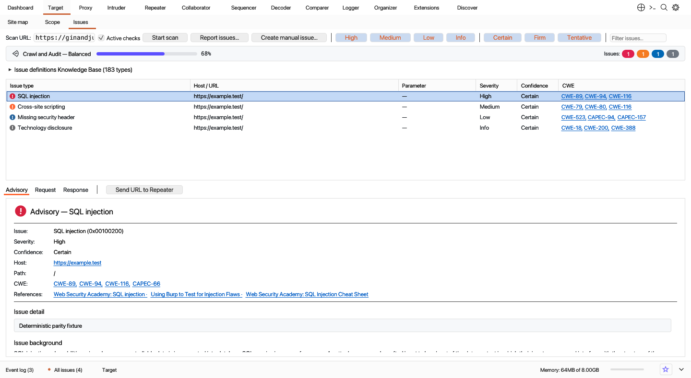

<div align="center">

# ⚡ Gulpsuite (`v0.0.2`)

**Ultra-Fast, Lightweight Native Rust Web Security Testing, DAST Vulnerability Scanner & HTTP/HTTPS/WebSocket Interception Proxy Suite**

[](https://github.com/Aryma-f4/gulpsuite/releases/latest)
[](https://github.com/Aryma-f4/gulpsuite/actions)
[](https://www.rust-lang.org/)
[](#why-gulpsuite-performance--memory-benchmarks)
[](#why-gulpsuite-performance--memory-benchmarks)
[](https://github.com/Aryma-f4/gulpsuite/releases/latest)
[](CODE_OF_CONDUCT.md)

[**Download v0.0.2 Installers**](https://github.com/Aryma-f4/gulpsuite/releases/tag/v0.0.2) · [**Screenshots**](#-visual-tour--screenshots) · [**Performance Benchmarks**](#why-gulpsuite-performance--memory-benchmarks) · [**Contributing**](CONTRIBUTING.md) · [**Security Policy**](SECURITY.md)

</div>

---

## Overview

**Gulpsuite** is a native, cross-platform web application security testing workbench, MITM HTTP/1.1, HTTP/2, TLS & WebSocket interception proxy, automated DAST vulnerability scanner, fuzzer, and request manipulation suite written 100% in Rust (`eframe` / `egui` + `tokio` + `rustls` + `rcgen`).

Designed for bug bounty hunters, penetration testers, red teams, and AppSec engineers who want a **full-featured desktop security suite that launches in `< 0.2 seconds` and uses `~50 MB` of RAM** without JVM garbage-collection pauses or multi-gigabyte memory bloat.

---

## Why Gulpsuite? (Performance & Memory Benchmarks)

| Metric | **Gulpsuite (`v0.0.2` Native Rust)** | Traditional JVM-Based Security Suites | Advantage |
|---|---|---|---|
| **Idle Memory (RSS)** | **~50 MB** | ~850 MB – 2.2 GB+ | **~20× – 40× lower RAM** |
| **Active Scan / Fuzzing Memory** | **~55 – 120 MB** (bounded ring buffers) | 2 GB – 6 GB+ | **Zero GC pauses or OOM freezes** |
| **Idle CPU Usage** | **0.0% – 0.4%** (reactive immediate-mode UI) | 3% – 12% | **Cooler laptop & longer battery life** |
| **Standalone Binary Size** | **~20 MB** | ~650 MB – 820 MB | **40× smaller footprint** |
| **Cold Startup Time** | **< 0.2 seconds** | 4 – 10 seconds | **Instant launch** |

---

## Cross-Platform Installers (`v0.0.2`)

Download pre-built native installers directly from [**GitHub Releases (`v0.0.2`)**](https://github.com/Aryma-f4/gulpsuite/releases/tag/v0.0.2):

| Platform | Architecture | Installer Packages | Format |
|---|---|---|---|
| **macOS (Apple Silicon)** | `arm64` | `Gulpsuite-0.0.2-macos-arm64.dmg` / `Gulpsuite-0.0.2-macos-arm64-setup.pkg` | macOS Disk Image (`.dmg`) & Native GUI Setup Package (`.pkg`) |
| **macOS (Intel)** | `x86_64` | `Gulpsuite-0.0.2-macos-x64.dmg` / `Gulpsuite-0.0.2-macos-x64-setup.pkg` | macOS Disk Image (`.dmg`) & Native GUI Setup Package (`.pkg`) |
| **Windows** | `x86_64` | `Gulpsuite-0.0.2-windows-x64-setup.exe` | Windows Graphical Setup Wizard (`.exe`) |
| **Linux** | `x86_64` | `Gulpsuite-0.0.2-linux-x64-setup.run` / `gulpsuite_0.0.2_amd64.deb` | Self-Extracting Setup Installer (`.run`) & Debian/Ubuntu Package (`.deb`) |

---

## 📸 Visual Tour & Screenshots

### 1. Dashboard (Light & Dark Themes)
Live task orchestration (`Live passive crawl from Proxy`, `Live audit from Proxy`, active/crawl scan tasks), categorized `Issue activity` with severity & confidence badges, interactive `Advisory` & `Request`/`Response` evidence tabs, and bottom `Event log` / `All issues` drawers.


---

### 2. New Scan Launcher (`Crawl and audit` / `Crawl` / `Audit selected items` / `API-only scan`)
Standalone scan configuration window featuring `#26649D` navigation tiles (`Scan details`, `Scan configuration`, `Application login`, `Resource pool`), full-card clickable scan type and preset cards (`Crawl strategy: Fastest / Faster / More complete / Most complete` & `Audit coverage: Critical issues only / Light / Medium / Thorough`), OpenAPI/SOAP/Postman API definition parser, and custom `.bcheck` support.


---

### 3. Target (`Site map` / `Scope` / `Issues` & 183-Type Knowledge Base)
Hierarchical host/folder/endpoint tree with custom vector node icons, responsive `Contents` & `Issues` split views, target scope inclusion/exclusion rules, animated `#5B4FFF` scanner progress bar with severity pills, baseline differential active/passive vulnerability verification, and a 183-entry vulnerability knowledge base with clickable CWE/CAPEC/reference hyperlinks.




---

### 4. Proxy (`Intercept` / `HTTP history` / `WebSockets history` / `Proxy settings`)
MITM HTTP/1.1, HTTP/2, TLS (dynamic per-host X.509 certificate minting via `rcgen` + `rustls` with shared client/server config caches), and WebSocket interception proxy with live `Intercept` queue, `Configure filter` modal (Settings mode & Bambda script mode), and 9-section `Proxy settings` (listeners, request/response/WebSocket interception rules, response modification rules, match & replace rules, TLS pass through, and miscellaneous options).


---

### 5. Intruder (`Sniper` / `Battering ram` / `Pitchfork` / `Cluster bomb`)
Multi-tab automated fuzzing and brute-force workbench with `§` payload position markers (`Add §`, `Clear §`, `Auto §` with mint-green `#CFE8DF` highlight spans), 19 payload generator types, 13-rule `Payload processing` pipeline, `Payload encoding`, `Resource pool` concurrency & throttling, `Grep - match / extract / payloads`, and real-time results table.


---

### 6. Repeater (`Getting started` & Multi-Tab Request/Response Workbench)
Interactive HTTP request manipulation and replay across multiple grouped tabs, featuring:
- **50/50 Getting Started guide** when first opened
- **Single-row Action Toolbar**: `Send` + `▼` group send (`sequence single connection`, `sequence separate connections`, `parallel`), `Cancel`, `<` / `History ▼` / `>` with per-tab exchange history, `Follow redirection`, tab-specific gear connection/header/redirect settings, and `Target:` / `Override SNI` configuration
- **Line-numbered `Request` & `Response` editors/viewers** with `[ Pretty | Raw | Hex | Render ]  [\n] [≡]` pill bars, full HTTP/HTML/JSON/JS syntax highlighting, and in-place right-click `Convert selection` (`Base64 encode/decode`, `URL encode/decode`, `HTML encode/decode`, `Hex encode/decode`).


---

### 7. Decoder, Comparer, Sequencer, Collaborator, Logger, Organizer, Extensions & Discover
- **Decoder**: Multi-layer `Smart decode`, URL, HTML, Base64, ASCII hex, Gzip, and SHA-256/SHA-512/MD5 transformations with live Text & Hex dump views and in-place selection conversion.
- **Comparer**: Word-level and Byte-level visual diff engine for comparing any two requests or responses.
- **Sequencer**: FIPS-style token randomness and entropy analyzer (character-level & bit-level uniformity across live captures or manual token lists).
- **Collaborator**: Out-of-band (OOB) HTTP/DNS/SMTP interaction client with payload generator and polling.
- **Logger**: Full-fidelity stream of HTTP, WebSocket, DNS, and SMTP traffic across all tools.
- **Organizer**: Long-term request/response storage with collections, notes, and search.
- **Extensions (Bambda)**: Live HTTP traffic filter and transformation scripting engine.
- **Discover**: Threaded directory and content discovery scanner.
- **In-App Auto-Updater**: Automatic startup & on-demand (`Help -> Check for updates…`, `Settings -> Suite -> Software Updates`, `Extensions -> Updates`) GitHub Releases checker with SHA-256 verification and 1-click native installer launch across macOS, Windows, and Linux.


---

## Building from Source

### Prerequisites
- Rust toolchain (`rustup`, `cargo` 1.78+)
- Python 3 (for cross-platform installer packaging)

### Build Release Binaries & Run Full Test Suite
```bash
./build.sh
```
This compiles the optimized release binaries (`./gulpsuite` and `./gulpsuite-setup`) and runs all 460+ unit, integration, and headless `egui_kittest` UI tests.

### Cross-Platform Installation
- **macOS / Linux**:
  ```bash
  ./install.sh
  # or launch the graphical setup wizard:
  ./gulpsuite-setup
  ```
- **Windows**:
  ```bat
  install.bat
  REM or launch the graphical setup wizard:
  gulpsuite-setup.exe
  ```

### Launch Gulpsuite
```bash
./gulpsuite       # macOS / Linux
gulpsuite.exe     # Windows
```

### Build macOS `.app` Bundle
```bash
./bundle.sh
open Gulpsuite.app
```

---

## Keyboard Shortcuts

| Shortcut | Action |
|---|---|
| `Cmd/Ctrl + R` | Send selected request to **Repeater** |
| `Cmd/Ctrl + I` | Send selected request to **Intruder** |
| `Cmd/Ctrl + F` | Open global Search |
| `Cmd/Ctrl + ,` | Open global Settings |
| `Alt + D / T / P / N / R / O / S / E / C / L / G / X / I` | Switch directly to Dashboard, Target, Proxy, Intruder, Repeater, Collaborator, Sequencer, Decoder, Comparer, Logger, Organizer, Extensions, or Discover |

---

## Community & Governance
- [Code of Conduct](CODE_OF_CONDUCT.md)
- [Contributing Guide](CONTRIBUTING.md)
- [Security Policy](SECURITY.md)

## License
Provided for authorized security testing, research, and educational use.
