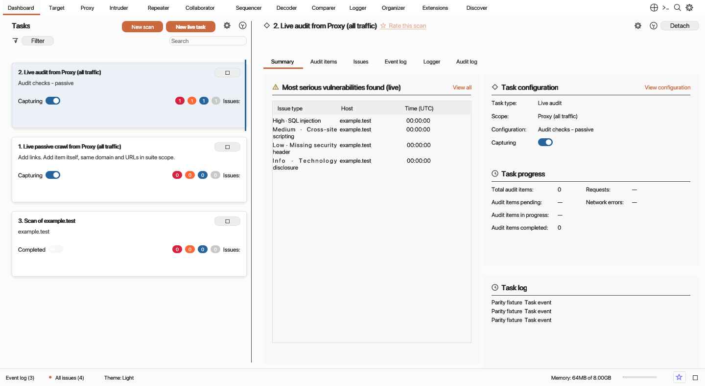
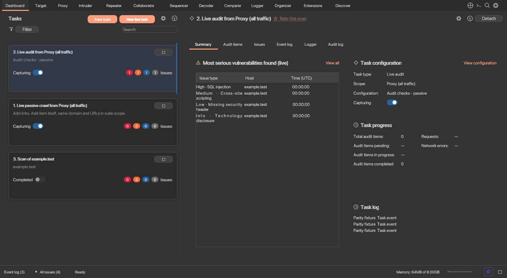
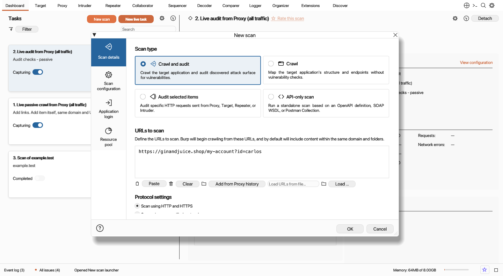
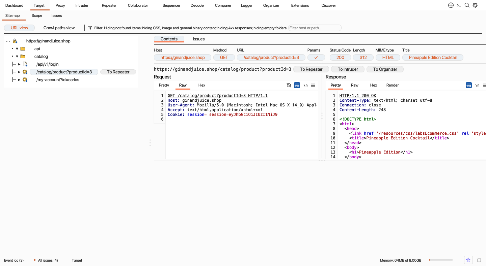
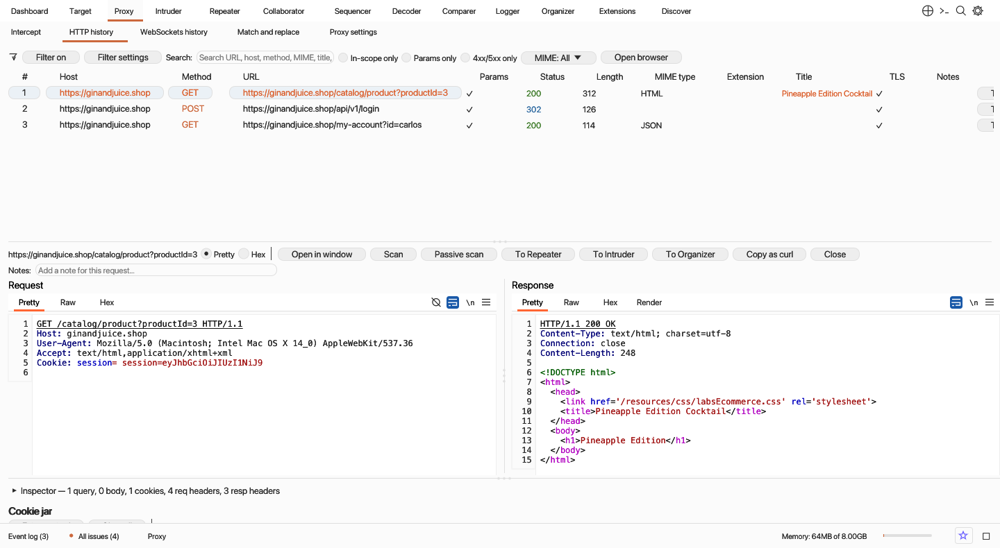
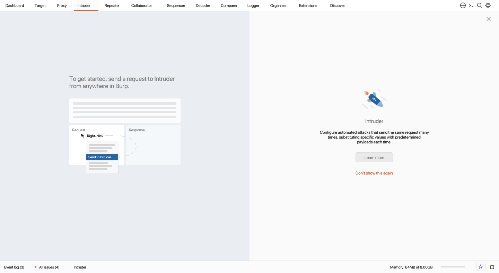
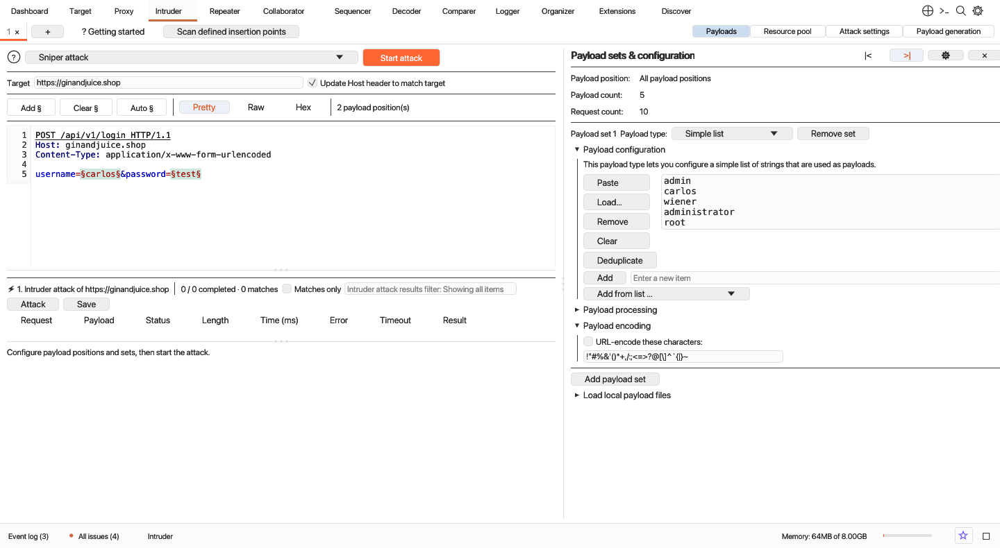
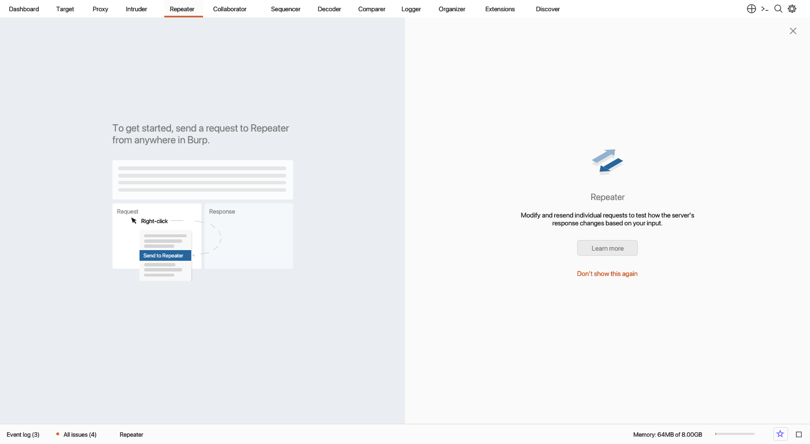
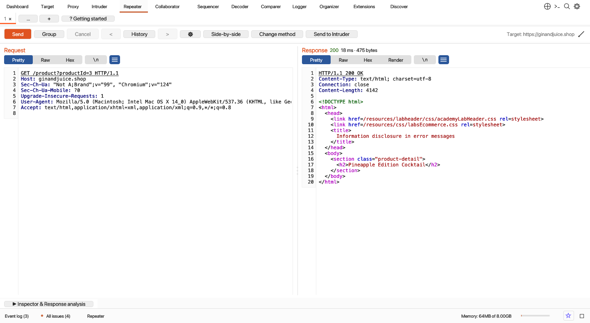
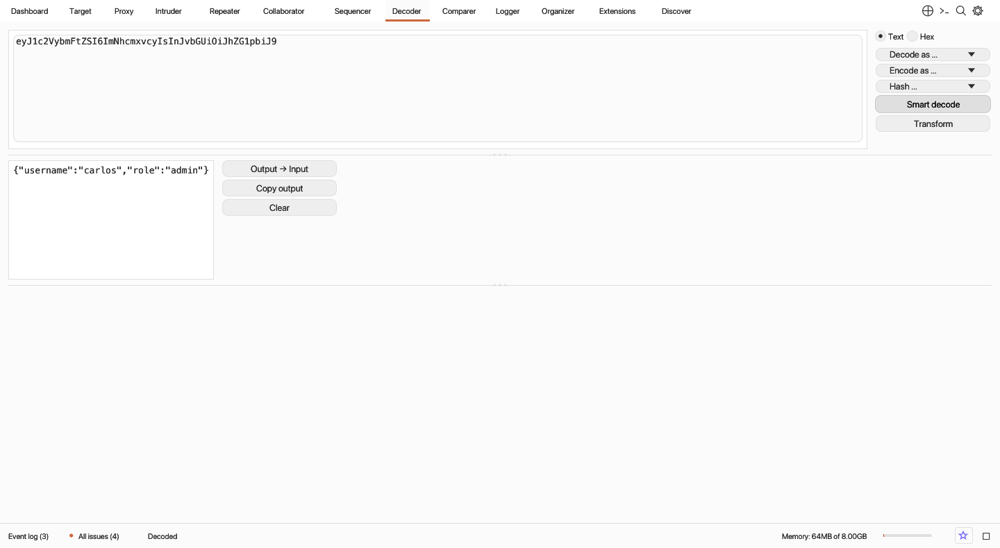

# Gulpsuite v0.0.1

**Gulpsuite** is a native, cross-platform web application security testing and HTTP/HTTPS interception suite built in Rust (`eframe` / `egui` + `tokio` + `rustls`).

---

## Screenshots

### 1. Dashboard (Light & Dark Themes)
Live task orchestration (`Live passive crawl from Proxy`, `Live audit from Proxy`, active/crawl scan tasks), categorized `Issue activity` with severity & confidence badges, interactive `Advisory` & `Request`/`Response` evidence tabs, and bottom `Event log` / `All issues` drawers.





---

### 2. New Scan Launcher (`Crawl and audit` / `Crawl` / `Audit selected items` / `API-only scan`)
Standalone scan configuration window featuring `#26649D` navigation tiles (`Scan details`, `Scan configuration`, `Application login`, `Resource pool`), full-card clickable scan type and preset cards (`Crawl strategy: Fastest / Faster / More complete / Most complete` & `Audit coverage: Critical issues only / Light / Medium / Thorough`), OpenAPI/SOAP/Postman API definition parser, and custom BChecks support.



---

### 3. Target (`Site map` / `Scope` / `Issue definitions`)
Hierarchical host/folder/endpoint tree with custom vector node icons, `Contents` & `Issues` split views, target scope inclusion/exclusion rules, and searchable vulnerability knowledge base.



---

### 4. Proxy (`Intercept` / `HTTP history` / `WebSockets history` / `Proxy settings`)
MITM HTTP/1.1, HTTP/2, TLS (dynamic per-host X.509 certificate minting via `rcgen` + `rustls`), and WebSocket interception proxy with live `Intercept` queue, `Configure filter` modal (Settings mode & Bambda script mode), and 9-section `Proxy settings` (listeners, request/response/WebSocket interception rules, response modification rules, match & replace rules, TLS pass through, and miscellaneous options).



---

### 5. Intruder (`Sniper` / `Battering ram` / `Pitchfork` / `Cluster bomb`)
Multi-tab automated fuzzing and brute-force workbench with `§` payload position markers (`Add §`, `Clear §`, `Auto §`), 19 payload generator types, 13-rule `Payload processing` pipeline, `Payload encoding`, `Resource pool` concurrency & throttling, `Grep - match / extract / payloads`, and real-time results table.





---

### 6. Repeater (`Getting started` & Multi-Tab Request/Response Workbench)
Interactive HTTP request manipulation and replay across multiple grouped tabs, featuring:
- **50/50 Getting Started guide** when first opened
- **Single-row Action Toolbar**: `Send` + `▼` group send (`sequence single connection`, `sequence separate connections`, `parallel`), `Cancel`, `<` / `History ▼` / `>` with per-tab exchange history, `Follow redirection`, tab-specific `⚙` connection/header/redirect settings, and `Target:` / `Override SNI` configuration
- **Line-numbered `Request` & `Response` editors/viewers** with `[ Pretty | Raw | Hex | Render ]  [\n] [≡]` pill bars and full HTTP/HTML/JSON/JS syntax highlighting.





---

### 7. Decoder, Comparer, Sequencer, Collaborator, Logger, Organizer, Extensions & Discover
- **Decoder**: Multi-layer `Smart decode`, URL, HTML, Base64, ASCII hex, Gzip, and SHA-256/SHA-512/MD5 transformations with live Text & Hex dump views.
- **Comparer**: Word-level and Byte-level visual diff engine for comparing any two requests or responses.
- **Sequencer**: FIPS-style token randomness and entropy analyzer (character-level & bit-level uniformity across live captures or manual token lists).
- **Collaborator**: Out-of-band (OOB) interaction client with payload generator and polling.
- **Logger**: Full-fidelity stream of HTTP, WebSocket, DNS, and SMTP traffic across all tools.
- **Organizer**: Long-term request/response storage with collections, notes, and search.
- **Extensions (Bambda)**: Live HTTP traffic filter and transformation scripting engine.
- **Discover**: Threaded directory and content discovery scanner.



---

## Cross-Platform Installers (`v0.0.1`)

| Platform | Architecture | Installer Packages | Format |
|---|---|---|---|
| **macOS (Apple Silicon)** | `arm64` | `Gulpsuite-0.0.1-macos-arm64.dmg` / `Gulpsuite-0.0.1-macos-arm64-setup.pkg` | macOS Disk Image (`.dmg`) & Native GUI Setup Package (`.pkg`) |
| **macOS (Intel)** | `x86_64` | `Gulpsuite-0.0.1-macos-x64.dmg` / `Gulpsuite-0.0.1-macos-x64-setup.pkg` | macOS Disk Image (`.dmg`) & Native GUI Setup Package (`.pkg`) |
| **Windows** | `x86_64` | `Gulpsuite-0.0.1-windows-x64-setup.exe` | Windows Graphical Setup Wizard (`.exe`) |
| **Linux** | `x86_64` | `Gulpsuite-0.0.1-linux-x64-setup.run` / `gulpsuite_0.0.1_amd64.deb` | Self-Extracting Setup Installer (`.run`) & Debian/Ubuntu Package (`.deb`) |

---

## Building & Running

### Prerequisites
- Rust toolchain (`rustup`, `cargo` 1.78+)
- Python 3 (for cross-platform installer packaging)

### Build Release Binaries & Run Full Test Suite
```bash
./build.sh
```
This compiles the optimized release binaries (`./gulpsuite` and `./gulpsuite-setup`) and runs all 450+ unit, integration, and headless `egui_kittest` UI parity tests.

### Cross-Platform Installation
- **macOS / Linux**:
  ```bash
  ./install.sh
  # or launch the graphical setup wizard:
  ./gulpsuite-setup
  ```
- **Windows**:
  ```bat
  install.bat
  REM or launch the graphical setup wizard:
  gulpsuite-setup.exe
  ```

### Launch Gulpsuite
```bash
./gulpsuite       # macOS / Linux
gulpsuite.exe     # Windows
```

### Build macOS `.app` Bundle
```bash
./bundle.sh
open Gulpsuite.app
```

---

## Keyboard Shortcuts

| Shortcut | Action |
|---|---|
| `Cmd/Ctrl + R` | Send selected request to **Repeater** |
| `Cmd/Ctrl + I` | Send selected request to **Intruder** |
| `Cmd/Ctrl + F` | Open global Search |
| `Cmd/Ctrl + ,` | Open global Settings |
| `Alt + D / T / P / N / R / O / S / E / C / L / G / X / I` | Switch directly to Dashboard, Target, Proxy, Intruder, Repeater, Collaborator, Sequencer, Decoder, Comparer, Logger, Organizer, Extensions, or Discover |

---

## License
Provided for authorized security testing, research, and educational use.
